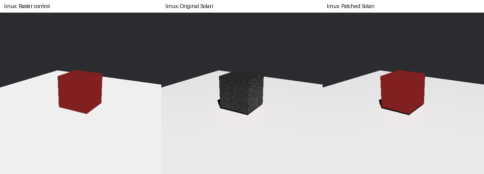

# Rendering reproducers

Small original Rust examples, procedural geometry and captured GPU output.
These examples are prepared for independent review; no submission has been made
to Bevy or wgpu. Build products
and raw crash logs belong outside this checkout. The current examples require
Rust 1.97.1 or later.

## 1. Metal top-level vec3 storage

Existing exact report: https://github.com/gfx-rs/wgpu/issues/5739.
Do not open a duplicate issue. The useful next contribution is updated evidence
and, if needed, a narrowly scoped workaround in a downstream renderer.

```bash
export CARGO_TARGET_DIR="${REPRO_DATA:-$HOME/data/bevy-render-repros}/cache/cargo-target"
cargo build --release --locked -p wgpu-vec3-repro
MTL_DEBUG_LAYER=1 "$CARGO_TARGET_DIR/release/wgpu-vec3-repro"
MTL_DEBUG_LAYER=1 "$CARGO_TARGET_DIR/release/wgpu-vec3-repro" --padded
MTL_DEBUG_LAYER=1 "$CARGO_TARGET_DIR/release/wgpu-vec3-repro" --scalars
```

The direct storage vector requests its WGSL size of 12 bytes. The padded case
allocates 16. The scalar struct also occupies 12 bytes and isolates vector
translation from a generic buffer problem. Successful runs read back and assert
the first three words. The padded case prints a fourth canary word; this helps
inspect writes but is not a proof of arbitrary backend memory safety.

Use `--signed` or `--float` for the other 32-bit scalar types. Use
`--msl <output.metal> --translate-only` to inspect Naga's emitted source without
requiring a GPU. Translation uses fake resource slots for readability; actual
dispatch uses wgpu's normal resource mapping.

`upstream/Cargo.toml` runs the same original code against a sibling `wgpu`
checkout. See the evidence record for the exact tested revision. It deliberately
contains path dependencies so no fork or public GitHub changes are needed.

## Procedural Bevy scene

```bash
cargo build --release --locked -p bevy-scene-repro
MTL_DEBUG_LAYER=1 "$CARGO_TARGET_DIR/release/bevy-scene-repro" \
  --out /absolute/scratch/raster.png --raster
MTL_DEBUG_LAYER=1 "$CARGO_TARGET_DIR/release/bevy-scene-repro" \
  --out /absolute/scratch/solari.png
```

One cube, one floor and one directional light; no GLB, external textures, DLSS,
downloads or window. The program requests an image screenshot after 100
updates and verifies it exists after 160. Raster provides a control.

To check the proposed downstream workaround, clone Bevy as a sibling folder,
check out `v0.20.0`, apply `patches/solari-metal-dispatch-padding.patch`, and build
`bevy-patched/Cargo.toml`. The patch only changes allocation size; the first
three words retain the indirect-dispatch layout. This is a workaround for
wgpu #5739 rather than a shader-translator fix.

```bash
git clone --branch v0.20.0 --depth 1 https://github.com/bevyengine/bevy.git ../bevy
git -C ../bevy apply ../bevy-render-repros/patches/solari-metal-dispatch-padding.patch
cargo build --release --locked --manifest-path bevy-patched/Cargo.toml
MTL_DEBUG_LAYER=1 "$CARGO_TARGET_DIR/release/bevy-scene-patched-repro" \
  --out /absolute/scratch/solari-padded.png
```

See [technical findings](review/01-metal-storage.md) and the captured
[raster](evidence/solari/raster.png) / [patched Solari](evidence/solari/solari-padded.png)
images. The unpatched Solari control aborts before screenshot capture.

## Review and publication

Bevy's policy prohibits AI-generated public prose and requires human ownership
and disclosure for code assistance. wgpu does not accept fully agentic PRs.
The evidence here supports independent technical review. A human needs to
understand the changes and independently write any eventual public Bevy issue
or PR description; do not paste these notes upstream.

Sources: https://bevy.org/learn/contribute/policies/ai/ and
https://github.com/gfx-rs/wgpu/blob/trunk/CONTRIBUTING.md.

## 2. Deferred unlit colors

See [unlit findings and patch commands](review/02-unlit-material.md).
The matrix compares original/patched Solari with raster and explicit-forward
controls at three exposures, with both ReSTIR settings.



