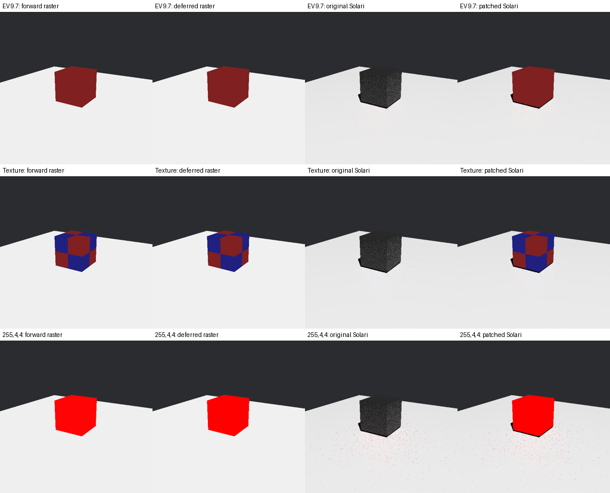
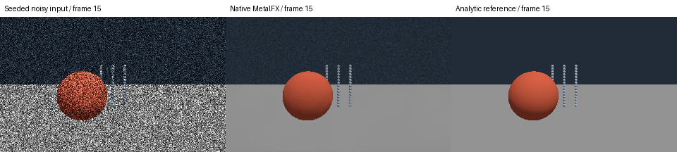
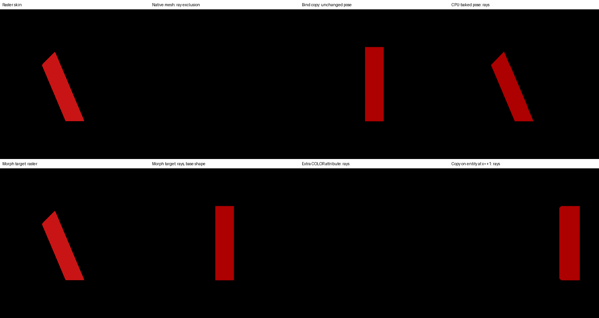

# Rendering reproducers

Small original Rust examples, procedural geometry and captured GPU output.
These examples are prepared for independent review; no submission has been made
to Bevy or wgpu. Build products
and raw crash logs belong outside this checkout. The current examples require
Rust 1.97.1 or later.

**All review notes, documentation patches and code comments in patches are
technical drafts prepared with AI assistance.** Under Bevy's AI policy they are
not submission text: before anything is submitted, a human contributor must
understand the change and write any issue, PR, comment or documentation prose
independently. See [Review and publication](#review-and-publication).

## Runs and evidence

Every matrix script writes to a **new** run folder, given with `--out` or by
default `$REPRO_DATA/runs/<name>-<host>-<UTC time>` (with `REPRO_DATA` defaulting
to `~/data/bevy-render-repros`). Scripts refuse an existing folder and any folder
inside this checkout, so recorded evidence is never rewritten. A reviewed run is
added to `evidence/` under a new name by an explicit copy, next to the earlier
records. Logs replace local paths with `$RUN_ROOT`, `$REPRO_REPO`,
`$CARGO_TARGET_DIR` and `~`. On macOS, Metal API validation is recorded from the
Metal runtime's own `Metal API Validation Enabled` log line; on Linux it is
recorded as not applicable.

## 1. Metal top-level vec3 storage

Existing exact report: https://github.com/gfx-rs/wgpu/issues/5739.
Do not open a duplicate issue. The useful next contribution is updated evidence
and, if needed, a narrowly scoped workaround in a downstream renderer.

```bash
export CARGO_TARGET_DIR="${REPRO_DATA:-$HOME/data/bevy-render-repros}/cache/cargo-target"
cargo build --release --locked -p wgpu-vec3-repro
MTL_DEBUG_LAYER=1 "$CARGO_TARGET_DIR/release/wgpu-vec3-repro"
MTL_DEBUG_LAYER=1 "$CARGO_TARGET_DIR/release/wgpu-vec3-repro" --padded
MTL_DEBUG_LAYER=1 "$CARGO_TARGET_DIR/release/wgpu-vec3-repro" --scalars
MTL_DEBUG_LAYER=1 "$CARGO_TARGET_DIR/release/wgpu-vec3-repro" --array --indirect
```

The direct storage vector requests its WGSL size of 12 bytes. The padded case
allocates 16. The scalar struct and `array<u32, 3>` also occupy 12 bytes and
isolate vector translation from a generic buffer problem. Successful runs read
back and assert the first three words. `--indirect` then uses those words as
indirect dispatch arguments and asserts that exactly 1 × 2 × 3 = 6 workgroups ran.
The padded case prints a fourth canary word; this helps inspect writes but is not
a proof of arbitrary backend memory safety.

Use `--signed` or `--float` for the other 32-bit scalar types. Use
`--msl <output.metal> --translate-only` to inspect standalone Naga output without
requiring a GPU. That translation uses default options and fake resource slots;
actual dispatch uses wgpu's normal resource mapping and compile options.
`uv run --script run_vec3_matrix.py` runs every case with both wgpu builds.

`upstream/Cargo.toml` runs the same original code against a sibling `wgpu`
checkout. See the evidence record for the exact tested revision. It deliberately
contains path dependencies so no fork or public GitHub changes are needed.

## Procedural Bevy scene

```bash
cargo build --release --locked -p bevy-scene-repro
MTL_DEBUG_LAYER=1 "$CARGO_TARGET_DIR/release/bevy-scene-repro" \
  --out /absolute/scratch/raster.png --raster
MTL_DEBUG_LAYER=1 "$CARGO_TARGET_DIR/release/bevy-scene-repro" \
  --out /absolute/scratch/solari.png
```

One cube, one floor and one directional light; no GLB, external textures, DLSS,
downloads or window. The program requests an image screenshot after 100
updates and verifies it exists after 160. Raster provides a control. Packet 2
adds `--unlit`, `--ev`, `--restir`, `--forward`, `--deferred` (deferred raster
control), `--texture`, `--color r,g,b` and `--lit-cube`.

The proposed downstream change is `patches/solari-dispatch-indirect-args.patch`:
it binds the dispatch buffer as a module-local `DispatchIndirectArgs` struct with
the same `x, y, z: u32` layout as the copies Bevy's meshlet shaders declare, so
the 12-byte allocation no longer depends on how Naga translates `vec3`.
`patches/solari-metal-dispatch-padding.patch` is kept as a clearly marked
**fallback** that only enlarges the allocation to 16 bytes.

`build_solari_variants.py` builds this scene against patched copies of the
released `bevy_solari` 0.20.0 crate from Cargo's registry; no Bevy checkout is
needed or modified. It checks embedded WGSL marker text: the struct and unlit
changes must be present exactly where applied. The padding fallback changes only
Rust, so markers can only show that it carries neither WGSL change; its effect is
shown by its Metal behaviour. The script records each binary's SHA-256 and keeps
copies of the binaries in its run folder.

```bash
cargo build --release --locked -p bevy-scene-repro
uv run --script build_solari_variants.py --out /new/variants
uv run --script run_bevy_cases.py /new/variants --out /new/solari-cases
```

See [technical findings](review/01-metal-storage.md) and
`evidence/solari-dispatch-mac/` / `-linux/`. The unpatched Solari control aborts
before screenshot capture on Metal. The original allocation-patch run against a
sibling Bevy checkout (`bevy-patched/Cargo.toml`) is kept in `evidence/solari/`.

## Review and publication

Bevy's policy prohibits AI-generated public prose and requires human ownership
and disclosure for code assistance. wgpu does not accept fully agentic PRs.
The evidence here supports independent technical review. A human needs to
understand the changes and independently write any eventual public Bevy issue
or PR description; do not paste these notes upstream. The same applies to the
documentation text and code comments inside `patches/`: each patch header marks
it as a technical draft, and that wording must be rewritten by the human
contributor before any submission.

Sources: https://bevy.org/learn/contribute/policies/ai/ and
https://github.com/gfx-rs/wgpu/blob/trunk/CONTRIBUTING.md.

## 2. Deferred unlit colors

See [unlit findings and patch commands](review/02-unlit-material.md).
The matrix compares original and patched Solari with **deferred raster**, the
exact reference, at three exposures with both ReSTIR settings, plus textured and
saturated colors, a lit-material regression control and a forward-materials
control in which Solari is bypassed. The patch fixes primary visibility only;
secondary rays and the path tracer still treat unlit surfaces as lit.




## 3. Embedded shader ordering and capture readiness

[Capture findings](review/03-capture-readiness.md) include a small original custom
material, tested registration-order controls and a proposed documentation patch.
These are integration lessons, not a new renderer bug report; the closest
existing report is Bevy #21600 (which links #6747).

## 4. Native MetalFX denoising and bridge proposal

[Native API proof and missing integration contract](review/04-metalfx.md) include
original analytic geometry, real Metal GPU output, an object-teleport history-reset
check, a reset-every-frame control and a kept-history control. This is not a live
Bevy plugin or vendor-quality ranking.



The same packet includes a prepared [Bevy 0.20 port of the existing upscaler
plugin](review/04-metalfx.md#additional-concrete-migration-patch), its original
procedural consumer and actual spatial/temporal output checks. Upscaling and
ray denoising remain separate features.

## 5. Skinned meshes and ray geometry

[Known limitation and prepared documentation change](review/05-solari-skinning.md)
compare native skinning, a stale bind-pose copy and an original CPU-baked control
on Metal and Vulkan, plus extra-attribute, morph-target and translated-entity
controls. Skinned meshes are excluded silently; morphed meshes are traced in their
base shape. No duplicate tracking issue is proposed.



Before any upstream push, inspect the proposed commits, their author and
committer, and every changed line:

```sh
git log --format=fuller <upstream-base>..HEAD
git log -p --format=%B <upstream-base>..HEAD \
  | rg -i 'co-authored-by|generated with|assisted-by|claude|codex|copilot|anthropic|openai|gemini|🤖|technical draft|ai assistance'
```

Review every match in context: legitimate crate names or code can also match.
Remove agent co-author trailers, tool footers and technical-draft patch headers
from the proposed upstream commits. Preserve any independently human-written
assistance disclosure required by the target project. Independently human-write
all eventual Bevy prose, including rustdoc and explanatory comments; human code
ownership and submission approval are still required.
