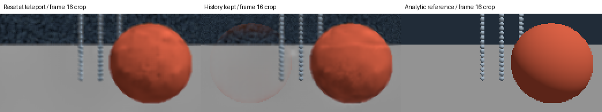

# MetalFX: native denoising proof and Bevy 0.20 upscaler port

**Prepared PR:** Port the existing [bevy_metalfx / ushas](https://github.com/mistakeknot/ushas) library, tools and CI to Bevy 0.20 / wgpu 30.
**Separate feature proposal:** A live MetalFX Solari denoiser bridge. Bevy's merged [#25123](https://github.com/bevyengine/bevy/pull/25123) already identifies the missing denoiser; no duplicate “macOS has no denoiser” bug is proposed. Tracker search checked 2026-10-10.

## Native denoising proof

An original analytic sphere/rod/plane fixture with seeded radiance noise feeds Apple's actual `MTLFXTemporalDenoisedScaler`. Three 32-frame replays compare coherent history, reset every frame and history kept across a frame-16 object teleport. This is not a camera cut or a proposed object-motion reset policy.

```sh
uv run --script metalfx/run_native.py --out /new/metalfx-run
```

On Apple M5 Pro/macOS 27.0.1, **96 frames complete with runtime-confirmed Metal API validation**, finite HDR readback and asserted reset equivalence. After settling, coherent mean-squared error is 0.33–0.55 times the reset-every-frame control. At the teleport, keeping history lowers whole-frame error but raises error over the old/new sphere positions (0.00131 versus 0.00119), leaving a local ghost. [Metrics and logs](../evidence/metalfx-history/) record the complete controls.



The fixture is an analytic diagnostic, not a physical path tracer or a vendor-quality benchmark. Motion/jitter are zero and view orientation is identity, so moving-camera guide conventions are untested. Linux can generate identical inputs but cannot execute MetalFX. macOS 26+ and device support for the denoised-scaler API are required.

## Concrete upscaler migration

[ushas-bevy-20.patch](../patches/ushas-bevy-20.patch) targets upstream `717a240038e9ee41ecec39591bed40f1240bd8eb`. It migrates RenderApp extraction, resolved compositing space, mapping/error cleanup, the GPU test API, separate tool packages/locks and CI. Rust **1.97.1** is the dependency minimum. Failed map callbacks remain unmapped; successful mappings are cleaned up on subsequent errors.

```sh
git clone https://github.com/mistakeknot/ushas.git ~/code/oss/ushas
git -C ~/code/oss/ushas checkout 717a240038e9ee41ecec39591bed40f1240bd8eb
git -C ~/code/oss/ushas apply "$PWD/patches/ushas-bevy-20.patch"
export CARGO_TARGET_DIR="${REPRO_DATA:-$HOME/data/bevy-render-repros}/cache/cargo-target"
cargo build --release --locked --manifest-path metalfx-plugin/Cargo.toml
uv run --script run_plugin_matrix.py --out /new/plugin-run
```

Clone this repro repository beside `ushas` under `~/code/oss/`; the consumer uses a sibling path. [Metal captures](../evidence/metalfx-plugin/comparison.png) confirm actual spatial/temporal `OutputWritten` plus screenshot readback under API validation. Linux asserts `UnsupportedPlatform` and unchanged fallback output.

Strict Clippy and library/tool tests pass on Mac Rust 1.97.1/1.99 and Linux 1.98.1, without deprecation exceptions. Linux: 82 library, 57 smoke, 69 benchmark, 4 timing-probe and 3 model tests; Mac smoke has 58 due to a platform-gated test. Mac checks also cover the Metal resolve test, feature sets, packaging and Swift/Python/Objective-C tests. Full interactive resize, moving-camera and presentation coverage is not claimed. The frozen external Bevy 0.19 consumer must migrate separately.

## Next integration step

The upscaler port **does not add ray denoising**. A live Solari denoiser still needs safe wgpu/native Metal encoding ownership, same-frame HDR/guide conversion, scheduling before tonemapping, and resize/cut/history handling. Begin at native resolution, test moving cameras/objects and keep label passes separate. Native Rust bindings exist in [objc2-metal-fx](https://docs.rs/objc2-metal-fx/latest/objc2_metal_fx/) and [mtl-fx](https://github.com/jasonherald/metal.rs); neither supplies that Bevy integration.

References: [Apple denoised-scaler API](https://developer.apple.com/documentation/metalfx/mtlfxtemporaldenoisedscalerdescriptor), [WWDC25](https://developer.apple.com/videos/play/wwdc2025/211/). Technical draft for review; [publication requirements](../PUBLICATION.md).
