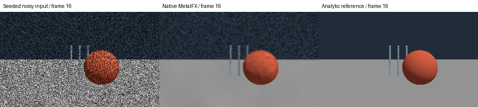
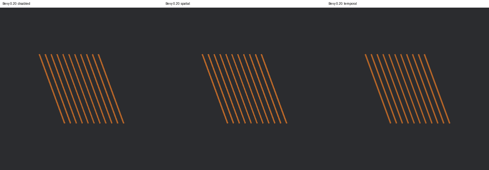

# MetalFX denoising: functional native proof and bridge proposal

This is a feature/integration packet, not a bug report. Read-only searches found
no dedicated denoiser issue in Bevy or the plugin tracker on 2026-10-10. Bevy's
merged [Metal support PR #25123](https://github.com/bevyengine/bevy/pull/25123)
already identifies the missing denoiser and mentions MetalFX as a possible route.
Do not open a duplicate "Metal does not denoise" bug.

## What runs

`metalfx/generate_guides.py` creates original analytic spheres, thin rods and a
plane, with seeded multiplicative radiance noise of known expectation. It is
**not** a physical path-tracer. There are no downloaded scenes or textures.
Depth is reversed-Z, matrices are right-handed/column-major, normals are world
space and roughness is exported perceptually and squared by the adapter. The
camera and geometry are static within each segment, so motion and jitter are 0.
At frame 16 the object jumps: that is a scene cut with an explicit history reset.

`metalfx/replay.swift` uses Apple's actual `MTLFXTemporalDenoisedScaler`, creates
textures with the API's requested usage, encodes Metal commands, waits for GPU
completion and asserts finite HDR readback. A reset-every-frame run is the control.
`metalfx/analyze.py` verifies guide ranges/normals, raw-data identity, finite
outputs, scene-cut reset equivalence and an observable temporal-history effect.

```sh
export REPRO_DATA="${REPRO_DATA:-$HOME/data/bevy-render-repros}"
uv run --script metalfx/generate_guides.py "$REPRO_DATA/guides"
MTL_DEBUG_LAYER=1 xcrun swift metalfx/replay.swift "$REPRO_DATA/guides" "$REPRO_DATA/coherent"
MTL_DEBUG_LAYER=1 xcrun swift metalfx/replay.swift "$REPRO_DATA/guides" "$REPRO_DATA/reset" --reset-every-frame
uv run --script metalfx/analyze.py "$REPRO_DATA/guides" "$REPRO_DATA/coherent" "$REPRO_DATA/reset" evidence/metalfx
```

Use new output directories; the programs deliberately refuse to overwrite them.
Build/raw products stay outside the repository. macOS 26+ and a device supporting
this API are required. A supported SDK alone does not establish device support.
Linux can generate the fixture, but cannot execute Apple's MetalFX API.

## Measured diagnostic

Apple M5 Pro, macOS 27.0.1: **64 completed GPU frames** (32 coherent + 32 reset
control), Metal API validation enabled. First-frame and cut-frame output match
the reset control within the asserted 0.0002 linear-HDR tolerance. On frame 15,
coherent versus reset output has MAE 0.00985, demonstrating actual history use.
Mean linear MSE against this analytic fixture is 0.04307 raw versus 0.0002451
coherent. These are diagnostic fixture values, **not a vendor-quality ranking**.

Initialization was 0.935 seconds. Median GPU command time including output
readback was 1.944 ms at 320×192; no complete-renderer speed claim is implied.
Swift typecheck and the Python assertions pass. PNGs use the same linear-to-sRGB
mapping for raw, denoised and reference, without a per-image exposure adjustment.




## Existing projects and useful next PR

- [bevy_metalfx / ushas](https://github.com/mistakeknot/ushas): released 0.4.2
  and current 0.5.0-rc.1 source still target Bevy 0.19 / wgpu 29. It implements
  upscaling and frame interpolation, not this denoising pass. Its Metal interop
  is useful reference; it is not a drop-in Solari denoiser.
- [mtl-fx](https://github.com/jasonherald/metal.rs): native Rust MetalFX bindings,
  not a Bevy renderer integration.
- [objc2-metal-fx](https://docs.rs/objc2-metal-fx/latest/objc2_metal_fx/): direct
  native bindings, including denoised scalers.

The useful first implementation PR would be **an optional Bevy 0.20 MetalFX
Solari denoiser plugin**, initially native resolution and no frame interpolation.
A safe bridge must:

1. Obtain Bevy/wgpu's Metal device, guide textures and encoding ownership without
   mixing unsafe native encoding with wgpu calls on the same live encoder.
2. Insert the pass after Solari shading and before tonemapping/presentation,
   reading the same frame's HDR color and guides; keep IDs outside the denoiser.
3. Convert/verify surface guides, depth direction, motion units/sign, normal space,
   roughness, camera matrices, jitter and exposure. Moving-camera/object tests are
   required: this zero-motion fixture does not validate those conventions.
4. Allocate outputs safely, preserve command ordering/lifetimes, handle resize,
   cuts, toggles and unsupported devices, and reset history once per discontinuity.
5. Compare passthrough/raw/denoised output with a moving procedural scene, with
   Metal validation and correct color-space handling, before making quality claims.

A live plugin is **not implemented** in this packet. The native API/data path is
proven; the Bevy/wgpu ownership, scheduling and guide conversion still require
engineering. Estimate several days for a first tested prototype, then further
review/coverage; this is an estimate, not measured implementation work.

Sources: [Apple API](https://developer.apple.com/documentation/metalfx/mtlfxtemporaldenoisedscalerdescriptor),
[WWDC25 session](https://developer.apple.com/videos/play/wwdc2025/211/),
[released plugin manifest](https://docs.rs/crate/bevy_metalfx/0.4.2/source/Cargo.toml).
No upstream implementation was copied into this example.

## Additional concrete migration patch

The native demo is separate from `patches/ushas-bevy-20.patch`, which ports the
existing upscaler plugin at `717a240038e9ee41ecec39591bed40f1240bd8eb` to Bevy 0.20.
Dependency bumps alone produced 24 library compilation errors. The patch updates
sub-app extraction labels/generics, queries `ResolvedCompositingSpace`, handles
fallible timestamp mapping, and migrates the existing GPU resolve test to the
new device/submission API. It raises the library MSRV to Bevy's 1.97.1.

```sh
git clone https://github.com/mistakeknot/ushas.git ../ushas
git -C ../ushas checkout 717a240038e9ee41ecec39591bed40f1240bd8eb
git -C ../ushas apply ../bevy-render-repros/patches/ushas-bevy-20.patch
cargo build --release --manifest-path metalfx-plugin/Cargo.toml
MTL_DEBUG_LAYER=1 "$CARGO_TARGET_DIR/release/metalfx-plugin-repro" spatial /absolute/new-spatial.png
MTL_DEBUG_LAYER=1 "$CARGO_TARGET_DIR/release/metalfx-plugin-repro" temporal /absolute/new-temporal.png
```

`metalfx-plugin` is an original offscreen 11-rod scene with no downloaded assets.
It waits for repeated **current-frame `OutputWritten` observations**, then also
verifies completed screenshot readback; configuration/encoded status alone is
not accepted as GPU output. Spatial and temporal upscaling both actually ran on
Metal under API validation, and differ from the same-scale disabled/bilinear
control. This does **not** add ray reconstruction or establish panel presentation.
The comparison is an output identity check, not an upscaler quality benchmark.



The plugin's 130 existing Mac library tests passed, including the explicitly
executed Metal resolve test. Its first migrated GPU test failed because the
new command-buffer finishing API requires an initialized ComputeTaskPool;
that test setup was corrected and the complete run passed. Initial diagnostics
are retained privately; this is a migration/setup issue, not a Bevy defect.

Reproduction driver: `uv run --script run_plugin_matrix.py` after building the
standalone manifest. On Linux it expects `UnsupportedPlatform`, captures the
fallback and never reports native MetalFX execution. The fixture generator also
ran on Linux; frame 15 SHA256 matches the Mac input exactly:
`bb81a5ff671cfb7cbd605edc4348c87273d8e0ddd1842caf88119d072b084a34`.

Mac Clippy passed with `-D warnings -A deprecated`: the exemption is for existing
Rust/glam deprecation warnings, not new migration diagnostics. It does not claim
an entirely warning-free upstream crate on Rust 1.99. Its default pinned 1.97.1
can be overridden with `RUSTUP_TOOLCHAIN=stable` for a current installed compiler.

Linux port coverage: **82 existing library tests passed** on Rust 1.98.1, release
build/check and Clippy completed, and all three procedural consumer modes completed
screenshot readback. Spatial/temporal report `UnsupportedPlatform`, with images
identical to the disabled control; no native execution is claimed. macOS and Linux
CI-style Clippy use the disclosed `-A deprecated` allowance.
