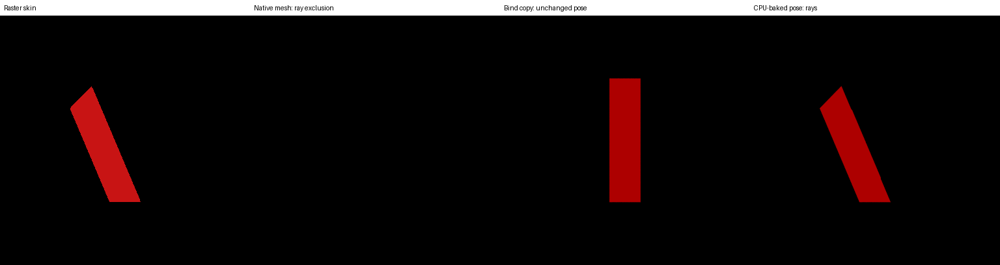

# Solari skinning: known limitation and documentation proposal

Tracker review first: [Solari #20203](https://github.com/bevyengine/bevy/issues/20203)
lists skinned/morphed meshes, [#7502](https://github.com/bevyengine/bevy/issues/7502)
tracks compute skinning, and [PR #23255](https://github.com/bevyengine/bevy/pull/23255)
is closed and unmerged. Its discussion includes previous-frame data and dispatch
size limits. No duplicate bug report or upstream submission is proposed.
All prose and the documentation patches are technical drafts prepared with AI
assistance; any Bevy submission needs independently human-written text.

## Original procedural reproducer

A two-joint prism bends its upper vertices by 0.8 radians. No downloaded meshes,
models, animations or textures are used. Each run requests an offscreen screenshot
after 140 updates and requires completed readback after 200. Three mesh choices,
two poses and raster/path-tracer controls produce 12 images per host; three
further controls add 6 more.

```bash
export CARGO_TARGET_DIR="${REPRO_DATA:-$HOME/data/bevy-render-repros}/cache/cargo-target"
cargo build --release --locked -p bevy-skinning-repro
uv run --script run_skinning_matrix.py --out /new/skinning-run
```

The path tracer requires supported hardware ray queries. Metal API validation is
enabled on macOS. Vulkan uses wgpu validation and readback; the tested Linux host
has no Khronos validation layers installed.

- **Native skinned mesh:** extra joint attributes fail the exact four-attribute
  compatibility check. Both poses have zero red pixels in the path tracer.
- **Separate compatible bind-pose copy:** raster skinning changes shape, but ray
  geometry remains straight. This is not a deformation update mechanism.
- **CPU-baked static pose:** ordinary four-attribute geometry matches GPU-skinned
  raster silhouettes exactly in raster. The bent path-traced silhouette has
  IoU 0.98454 with raster; the stale bind-pose ray silhouette has IoU 0.19696.

Both macOS Metal and Linux Vulkan produced these results (24 completed captures).

Three controls separate the mechanisms (`evidence/skinning-controls-mac/`,
`-linux/`, 36 captures; the 12 original images are byte-identical to the
recorded ones on both hosts although the binary now enables Bevy's `morph`
feature):

- **Extra attribute, no skin:** an unskinned mesh with one additional `COLOR`
  attribute renders in raster and has **zero** path-traced pixels. The exact
  attribute comparison excludes it, independently of skinning, and nothing warns.
- **Morph target:** a mesh with exactly the four attributes and one morph target
  equal to the baked pose, at weight 1. Raster morphs it exactly like the baked
  pose (identical silhouette). The path tracer draws the **unmorphed base shape**:
  IoU 1.0 with the straight raster prism and 0.19696 with the morphed raster.
  Skinned meshes are excluded, but morphed meshes are traced stale, silently.
- **Copy on a translated skinned entity:** the bind-pose copy is attached to a
  skinned entity at x = +1. Skinning ignores the entity's transform, so the raster
  silhouette is unchanged, while the ray copy follows the entity's transform:
  ray/raster IoU 0.0, centroid shift 116.5 px.
The baked control proves a static geometry route, not interactive skin-cache
performance or correctness of motion vectors across animation frames. It covers
only an identity entity transform. With real glTF skins, where the mesh entity
sits under an armature and joints carry world transforms, a baked pose attached
to the skinned entity must be expressed in that entity's local space,
`inverse(entity GlobalTransform) * Σ wᵢ · jointᵢ · inverseBindᵢ`, or the static
mesh must go on a separate unskinned entity. Colors serve only as a silhouette
mask; this is not a path-tracer unlit-material test.




## Prepared small PR

`patches/solari-skinning-docs.patch` targets Bevy v0.20.0
`b3bdd75becaffe9a16677cf5bae5bd6d198f052b`; the `-main` variant targets inspected
main `0e93c7ab7d5ec016990dcb226ec544aee1636d70`.
The main revision changed the raytracing opt-in API but retains the exact attribute
restriction. Both patch applicability checks passed. Runtime evidence is against
released 0.20.0; current-main runtime was not tested for this fixture. On main the
compatibility check is the same apart from the opt-in, and incompatible meshes are
also skipped silently.

The proposed documentation says **exactly** these four attributes in their
default formats (the check compares formats too), and states separately that
incompatible meshes are skipped without a warning, that skinned meshes are
skipped because joint attributes are extra vertex attributes, that morph targets
are ignored so a compatible morphed mesh is traced in its base shape, and that a
separate static pose mesh does not follow later deformation and is placed by the
entity's transform, which skinning does not apply. These statements come from
`is_mesh_raytracing_compatible`, which compares only attribute ids/formats,
topology and index type, and from the controls above; neither release nor main has
skin or morph handling in `bevy_solari`. The patch does not implement skinning or
add noisy warnings for all assets (which may never be used by a RaytracingMesh3d
entity).

## Larger contribution, separately scoped

A compute skin-cache contribution would need per-instance deformed positions,
normals and tangents; pose history; render extraction/synchronization; skinning
before BLAS updates and ray tracing; correct previous-frame geometry without
invalidating double-buffered TLAS state; bounds and dispatch chunking; resizing
and lifetime handling; and optional morph support. First agree that contract with
maintainers, then submit original static/two-pose acceptance fixtures with an
incremental compute implementation. Reusing a shared mesh's bind-pose BLAS for
multiple differently posed instances is not a correct implementation.

This preparation deliberately leaves the full renderer feature unfinished.
Independent human ownership, code review and independently written Bevy public
prose are required before any eventual upstream PR.
